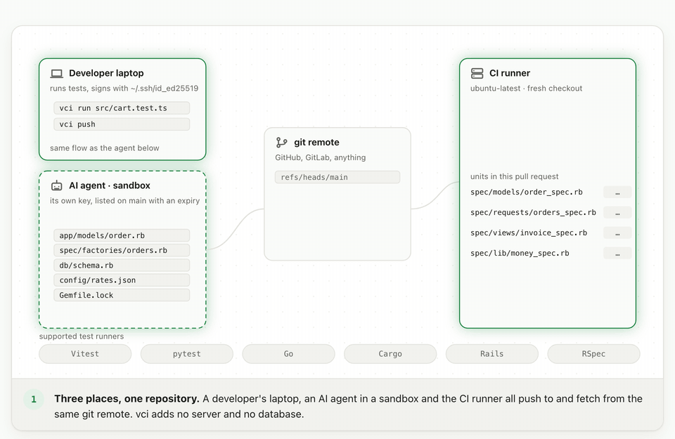
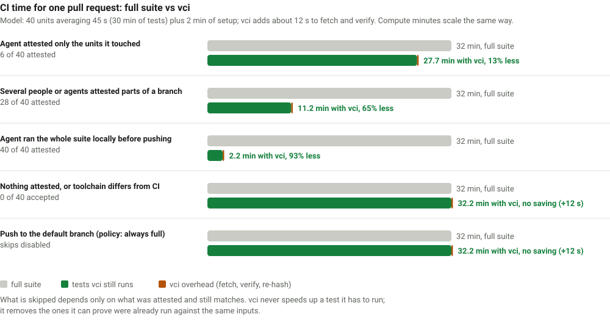

# vci

**Run a test once, prove it, and let CI skip it.**

vci is a command-line tool and a GitHub Action. A developer or an AI agent runs some tests on their own machine; vci records exactly what those tests depended on, signs that record, and stores it in git. When the pull request reaches CI, vci checks each record and runs only the tests nobody has already run against the same inputs.

```
$ vci plan --base-ref origin/main
SKIP spec/models/order_spec.rb     (attested by alice@example.com (SHA256:tsNeKgQt…))
SKIP services/pricing              (attested by build-agent (SHA256:RASHZ3Nm…))
RUN  spec/requests/orders_spec.rb  (no attestation)
RUN  services/billing              (no valid attestation (1 candidates; best failed inputs: entry:services/billing/rates.json))
2 to skip, 2 to run
```

Works with **Vitest, pytest, Go, Cargo, Rails (Minitest) and RSpec**, on macOS and Linux. Apache-2.0.



<sub>The same animation, with controls, is on the <a href="https://pandelisz.github.io/cryptographically-verifiable-ci-runner/">docs site</a>.</sub>

Docs: [pandelisz.github.io/cryptographically-verifiable-ci-runner](https://pandelisz.github.io/cryptographically-verifiable-ci-runner/) · [Examples with real output](https://pandelisz.github.io/cryptographically-verifiable-ci-runner/examples.html) · [Full reference](docs/REFERENCE.md)

## The problem

CI runs the whole test suite on every push. Most of those tests were just run, with the same code, on the machine that made the change. With AI agents producing many small pull requests, that waste grows: an agent runs the tests that cover its change, pushes, and CI runs all of them again, plus everything else.

The obvious fix, "trust the pull request when it says the tests passed", is not safe. A claim is not a proof. The code may have changed since the run, a dependency may differ, the person or agent may be mistaken or malicious, and the CI machine is not the laptop.

## What vci does

vci turns "I ran the tests" into something CI can check.

1. **Record.** `vci run` executes the tests with a collector attached to the test runner. The collector observes every file the test read, every file it looked for and did not find, every directory it listed, every package it loaded and every environment variable it consulted. vci hashes all of it.
2. **Sign.** The result (what ran, against which hashes, with which toolchain, by whom) is signed with the developer's or agent's SSH key as an [in-toto](https://in-toto.io/) attestation.
3. **Share.** The attestation is stored as [git-meta](https://git-meta.com/) metadata on the test's path and pushed with `vci push`. It travels through git; there is no server and no database.
4. **Verify.** In CI, `vci ci` reads the trusted keys and policy from the *base* branch, checks each signature, re-hashes every recorded input from CI's own checkout, and skips a test only when everything matches. Then it runs the rest.

## Why it is safe

- **Fail open.** The default is to run. Any mismatch, missing key, expired attestation, unreadable record or unexpected behaviour means the test runs. A mistake can only cost a skip, never cause one.
- **Observed inputs, not guesses.** Dependencies are recorded from what the test actually did at run time, not inferred from imports. A fixture file read with `open()`, a template rendered on demand, a module loaded by name: all recorded. Anything the collector cannot see, such as a child process or a network call, makes the test ineligible.
- **Trust comes from the base branch.** The list of accepted keys and the policy are read from the commit the pull request targets, so a pull request cannot add its own key or loosen the rules.
- **Signed by identity, checked by content.** Each attestation names who signed it, and CI re-derives every hash itself. Nothing in the stored record is trusted on its own.

What vci does not do: it cannot tell whether a trusted signer lied. Keep the signer list short, give agents their own keys with expiry dates, and keep full runs on your default branch. The [threat model](docs/REFERENCE.md#threat-model-v1) has the details.

## What it saves



The saving is exactly the tests that were attested and still match; the cost is about ten seconds to fetch and verify. When nothing was attested, when the toolchain differs from CI, or on your default branch (where policy runs everything), the suite runs in full as before. Compute minutes follow the same proportions as time.

## Quick start

Install (needs `git`, a Rust toolchain and `ssh-keygen`):

```sh
curl -fsSL https://raw.githubusercontent.com/PandelisZ/cryptographically-verifiable-ci-runner/main/scripts/install.sh | sh
```

In your repository, once:

```sh
vci init --adapter pytest --key ~/.ssh/id_ed25519.pub   # or vitest, go, cargo, rails
git add vci.toml .vci/allowed_signers .git-meta && git commit -m "Enable vci"
# Merge this to your default branch: trust is read from there.
```

Every day:

```sh
vci run tests/test_orders.py --key ~/.ssh/id_ed25519   # run, record, sign
vci plan --base-ref origin/main                         # what CI will skip
vci push && git push                                    # share the attestation and your branch
```

In GitHub Actions, after your toolchain setup steps:

```yaml
- uses: PandelisZ/cryptographically-verifiable-ci-runner@<commit-sha>
```

The action downloads a prebuilt `vci`, fetches the attestations, prints the plan in the job summary, runs what is left, and fails the job if any of it fails. Setup and security notes: [docs/GITHUB_ACTIONS.md](docs/GITHUB_ACTIONS.md).

## Test runners

| Adapter | Unit that can be skipped | Inputs found by |
|---|---|---|
| `vitest` | test file | observing the module graph, file and env reads |
| `pytest` | test file | Python audit hooks and the import system |
| `go` | package | `go list` plus a logger built into the test binary |
| `cargo` | test target (`crates/x#lib`, `#test:name`) | conservative: every file of the crate and its in-repo dependencies |
| `rails` | Minitest or RSpec file | a Ruby collector wrapping file, env and process entry points |

Each adapter runs every unit in its own process, prepares fresh state (for Rails, a fresh database from the schema), and refuses to attest a unit whose test was skipped, failed, or did something the collector cannot follow. Toolchain versions must match between the machine that attested and CI; the docs say what to pin for each runner.

## How a skip is decided

```
laptop / agent                              CI (pull request)
──────────────                              ─────────────────
vci run tests/test_b.py                     vci ci --base-ref <base>
  run test with collector                     read allowed_signers + vci.toml from <base>
  hash 318 inputs → root 21ff5d…              fetch refs/meta/main
  sign with ~/.ssh/id_ed25519                 for tests/test_b.py:
  store on path:tests/test_b.py                 signature by a key in allowed_signers?  ✓
vci push  ──── refs/meta/main ────▶             not expired, same toolchain?            ✓
                                                re-hash all 318 inputs here: same root? ✓
                                              → SKIP. Everything else → RUN.
```

If a test is not skipped and you expected it to be, `vci explain <unit> --base-ref origin/main` names the first check that failed and, for inputs, the file and both hashes.

## Learn more

| | |
|---|---|
| [Get started](https://pandelisz.github.io/cryptographically-verifiable-ci-runner/get-started.html) | Requirements, install, repository setup, agents |
| [Examples](https://pandelisz.github.io/cryptographically-verifiable-ci-runner/examples.html) | A full round trip with real output; setup per runner; what refusals look like |
| [Test runners](https://pandelisz.github.io/cryptographically-verifiable-ci-runner/adapters.html) | What each adapter records, refuses and needs pinned |
| [How it works](https://pandelisz.github.io/cryptographically-verifiable-ci-runner/security.html) | Attestations, verification, threat model |
| [Reference](docs/REFERENCE.md) | Everything, in one long document |
| [Design notes](docs/PLAN.md) | The original plan and the research behind it |

This repository is also the demo: `demo/` holds a project for every adapter, and [the CI workflow](.github/workflows/ci.yml) runs them through the action on each pull request. [Pull request 4](https://github.com/PandelisZ/cryptographically-verifiable-ci-runner/pull/4) shows units attested on a Mac being skipped on a Linux runner.

## Status

Version 0.3. Each adapter has an end-to-end test suite and has been verified against adversarial tests that try to produce a false skip; findings and remaining limits are listed under [Known gaps](docs/REFERENCE.md#known-gaps). Verification of a trusted signer's honesty (random re-runs in CI) is planned, not built.

## License

Apache License 2.0. See [LICENSE](LICENSE).
