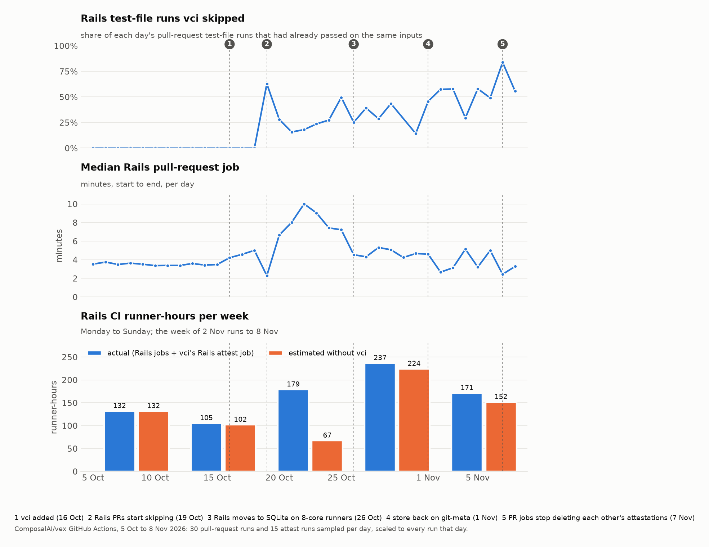

# CI is the bottleneck now. vci lets CI skip what was already run, with proof.

*The project, written for Hacker News readers: the problem, where the numbers come from, how it works, and where it
falls short.*

## Coding stopped being the constraint

For twenty years CI was sized for human output: a few pull requests per engineer per week, one pipeline run each.
That arithmetic broke in 2025–2026, and the people who broke it first have written down what happened.

Anthropic, September 2026, on scaling its test-selection service ([Malhotra][1]):

> Writing code is no longer the constraint, and once PR review gets accelerated, CI starts feeling the pressure.

The same post gives the numbers: engineers there "ship 8x as much code per quarter as they did from 2021-2025",
"Claude authors 80% of that code", "the amount of tests across our codebase grew 10x and we added a nominal amount of
engineers", and "this all led to a 25x increase in CI jobs over a six month period". The service that decided which
tests to run on each PR was patched three times (a bigger machine, sharding, daily restarts) before being rebuilt.
The advice at the end: "assume your architecture will be at a 25x load within two quarters."

A month later, in a post about replacing git for their monorepo ([Anthropic, October 2026][2]):

> At Anthropic, coding is no longer the bottleneck to building systems or doing research. […] The bottleneck, now, is
> all of the developer infrastructure built for human scale: source control, builds, and CI.

and, further down:

> What does CI even mean when hundreds or even thousands of changes can merge while tests are running?

It is not only Anthropic. Boris Cherny, who leads Claude Code, [wrote on X][3] in January 2026 that his own code had
been "100% for two+ months now, I don't even make small edits by hand. I shipped 22 PRs yesterday and 27 the day
before, each one 100% written by Claude." Linear titled its September 2026 engineering post
["AI coding has made CI a bottleneck, so we reworked ours to keep up"][4]: their test suite nearly quadrupled in a
year and grows by about 2,000 tests a week. Spotify's engineering blog reported [76% more PRs to review][5] after
rolling out agents. CircleCI's 2026 report, across 28 million workflows, found workflow throughput up 59% while
[main-branch success rates fell to 70.8%][6], a five-year low: more code than ever, and less of it getting through.

The pattern in all of these is the same. Agents removed the cost of producing a change. They did not remove the cost
of knowing whether to trust it. That cost now lands on review and on CI, and it lands all at once.

## The part nobody can skip

The industry answer so far is to make CI faster: better runners, caching, sharding, and *test impact analysis*, which
picks the tests a change could affect and runs only those. Anthropic's post is about exactly that service. Linear's
is about shaving setup time and sharding smarter. These help, and they are necessary.

But look at what every one of those pipelines still does: it re-runs tests that the person or agent who made the
change ran minutes earlier, on the same code. An agent edits a model, runs the three specs that cover it, sees them
pass, and opens a PR. CI then runs those three specs again, plus everything else. The work was done; the result was
thrown away because CI had no reason to believe it.

That is the gap vci is aimed at. Not "run fewer tests" in the test-impact-analysis sense, which guesses from history
and dependency graphs which tests *might* matter. Rather: "don't run a test twice", with a record CI can check rather
than believe.

## What vci does

vci is a Rust CLI and a GitHub Action. It makes "I ran the tests" into something CI can verify.

1. **Record.** `vci run tests/test_orders.py` runs the test with a collector attached to the test runner. The
   collector observes every file the test read, every file it looked for and didn't find, every directory it listed,
   every package it loaded and every environment variable it consulted. vci hashes all of it (BLAKE3) into one root.
2. **Sign.** The record, meaning what ran, against which hashes, with which toolchain, by whom, is signed with the
   developer's or agent's SSH key as an [in-toto](https://in-toto.io/) attestation, in the SSHSIG format that
   `git commit -S` already uses. A CI job can sign keylessly instead, with its GitHub OIDC token through Sigstore.
3. **Share.** The attestation is stored as [git-meta](https://git-meta.com/) metadata on the test's path and pushed
   with `vci push`. It travels through git on `refs/meta/main`. There is no server and no database. (A SQLite,
   PostgreSQL or libSQL store can be used instead; the numbers below are all from git-meta.)
4. **Verify.** In CI, `vci ci` reads the trusted keys and policy from the *base* branch (never from the pull
   request), checks each signature, re-hashes every recorded input from CI's own checkout, and skips a test only when
   everything matches. Then it runs the rest.

```
$ vci plan --base-ref origin/main
SKIP spec/models/order_spec.rb     (attested by alice@example.com (SHA256:tsNeKgQt…))
SKIP services/pricing              (attested by build-agent (SHA256:RASHZ3Nm…))
RUN  spec/requests/orders_spec.rb  (no attestation)
RUN  services/billing              (no valid attestation (1 candidates; best failed inputs: entry:services/billing/rates.json))
2 to skip, 2 to run
```

The default is to run. Any mismatch, missing key, expired record, unreadable metadata or unexpected behaviour means
the test runs. A mistake can only cost a skip, never cause one.

## Why observed inputs, not a dependency graph

Test impact analysis works from what a change *could* affect: an import graph, a package map, or a history of which
tests failed when which files changed. Those are guesses, and they are the reason such systems are tuned for "run a
bit too much" rather than "run exactly enough". Anthropic describes theirs as choosing "based on past performance and
package relevance"; when its listener lagged, the symptom was "running tests that were already super flaky or
widespread-failing across the board".

vci records what a test *did*. The adapters hook the runner at run time:

| Runner | Unit | How inputs are observed |
|---|---|---|
| Vitest | test file | Vite module graph plus patched `fs` and `process.env` in the worker |
| node:test | test file | Node's module hooks plus patched `node:fs` and `process.env` in the test process |
| pytest | test file | `sys.addaudithook` plus the import system; one process per file |
| Go | package | a logger overlaid into the standard library for the test build, so it sees package init too |
| Cargo | test target | no runtime hook exists, so every file of the crate and its in-repo deps counts (weaker, and documented) |
| Rails, RSpec | test file | a Ruby collector wrapping file, env and process entry points; the test database is the engine's |

A fixture read with `open()`, a template rendered on demand, a module loaded by name, a file that was looked for and
not found: all recorded, all hashed. Each unit runs in its own process. Anything the collector cannot follow (a child
process, a socket, an `ENV` enumeration, a read through a C extension) makes the test ineligible rather than guessed
at; it simply runs in CI as before.

Environment variables are three short lists in `vci.toml`: `set` (vci sets them, the same everywhere), `hash`
(taken from the machine and hashed) and `ignore` (visible, never hashed); every other variable is removed from the
test process.

## Why a signature, and why trust comes from the base branch

A cache keyed by input hash, which is what Turborepo, Nx and Bazel remote caches are, trusts whoever can write to
the cache. Nx's CVE-2025-36852 ("CREEP") was that trust being abused: a poisoned entry from a PR served to main.

vci has no shared cache to poison. Every attestation names its signer; CI re-derives every hash itself; and the list
of accepted keys plus the policy come from the commit the PR targets, so a PR cannot add its own key or loosen the
rules. Metadata on its own is never trusted: anyone with push access can delete or overwrite it, and the only effect
is that a test runs.

## What it does not protect against

A signature proves who claimed a result, not that they were honest. If a key listed in `allowed_signers` lies about
a test passing, vci believes it. Mitigations today: keep that list short, give agents their own keys with expiry
dates, and keep full runs on the default branch (the `vci init` default), so a false claim is caught at merge.
Random re-execution of attested tests in CI is the planned next step; it is not built.

Other limits, stated plainly: Rust has no runtime read hook, so the cargo adapter is conservative rather than
precise; reads inside C extensions (some SQLite paths, lxml, libvips) are invisible and cause refusals; a test that
reads `CI` or `HOME` will never match between a laptop and a runner; toolchains must match exactly (same Python
build, same Go version, same rustc), which takes some pinning to get right across macOS and Linux.

Every adapter was tested adversarially with the question "can I get a false skip?". Those rounds found about forty
ways (fixtures copied into temp dirs, stale bytecode, worker-thread reads, pending RSpec examples counted as passes,
…); all are now refusals or recorded inputs. There are surely more, and that is the most useful thing to hear about.

## Try it in two minutes

```sh
brew install pandelisz/tap/vci                 # macOS and Linux; or scripts/install.sh
cd your-project                                # a git repo with tests
vci init --adapter pytest --key ~/.ssh/id_ed25519.pub   # or vitest, go, cargo, rails
git add vci.toml .vci/allowed_signers .git-meta && git commit -m "Enable vci"   # merge to main: trust is read from there
vci run tests/test_orders.py --key ~/.ssh/id_ed25519
vci plan --base-ref origin/main
```

In GitHub Actions, after your toolchain setup: `- uses: PandelisZ/cryptographically-verifiable-ci-runner@v2`.
The action downloads a prebuilt binary, fetches the attestations, prints the plan in the job summary, and runs the
rest. The repository is its own demo: the open demo PRs show units attested on a Mac being skipped by the Linux
runner, and re-running when an input changes.

## Results on our monorepo

These numbers are from production, not a benchmark: our own monorepo, [ComposalAI/vex][7], read from its GitHub
Actions history. The jobs API gives when each job started and ended; each job's log gives vci's plan
(`N to skip, M to run`) and its `VCI_TIMING` lines. Our Rails suite is about 2,350 test files, split over two CI
jobs per pull request.

We added vci on 16 October, and Rails pull-request jobs started skipping on 19 October. The chart covers 5 October to
8 November. For each day we read 30 pull-request runs and 15 runs of vci's attest workflow, spread over the day, and
scaled them to every run that day.



| Week (Mon–Sun) | Rails runs | Test-file runs skipped | Median PR job | Runner-hours, with vci | Without vci (est.) | Cost, with vci | Without vci (est.) |
|---|---|---|---|---|---|---|---|
| 5 Oct | 1,624 | 0% | 3.5 min | 132 | 132 | $333 | $332 |
| 12 Oct (vci added) | 1,268 | 0% | 3.6 min | 105 | 102 | $266 | $257 |
| 19 Oct | 844 | 32% | 7.4 min | 179 | 67 | $451 | $169 |
| 26 Oct | 1,860 | 33% | 4.6 min | 237 | 224–249 | $312 | $297–329 |
| 2 Nov | 1,902 | 56% | 3.2 min | 171 | 152–167 | $226 | $200–220 |

"With vci" counts the Rails test jobs and vci's Rails attest job. "Without vci" is an estimate of the same jobs each
running the whole suite plainly. Until 26 October the jobs ran on 16-core runners with MySQL, and the estimate is the
plain jobs of the week before vci, scaled to the suite's size. From 26 October they run on 8-core runners with
SQLite, where no plain job has ever run. There the estimate is that week's jobs that ran everything, with vci's own
steps taken out and their tests counted 5 to 17% faster, which is what vci's one process per file cost on 26
October. The cost is what those runner minutes cost on GitHub's hosted Linux runners ($0.042 a minute for 16 cores,
$0.022 for 8, $0.012 for 4). Our runners are self-hosted, so it is an equivalent, not our bill.

### What improved

**Duplicate test work.** Before vci, every pull-request job ran every Rails test file. In the week of 2 November,
56% of test-file runs were skipped, and on the best day, 7 November, 84%. Nearly all of it is CI not repeating CI. In
eight job logs we sampled, almost every skip was attested by the pull-request CI key: an earlier push of the same
pull request, or another pull request on the same files, had already run the test. At most seven skips per job came
from a developer's laptop.

**Pull-request feedback.** The median Rails job went from 3.5 minutes before vci to 3.2 minutes in the week of 2
November, and 2.4 minutes on 7 November, on runners with half the cores. A job that skipped most of its files took 2
min 24 s: 1 min 22 s of setup (checkout, system packages, gems), 29 s of tests and 30 s of vci.

### What has not improved yet: total runner time

Our Rails CI has not got cheaper in total. From 19 October to 8 November, vci cost more runner time than it saved:
587 runner-hours, against an estimated 443 to 483 without it.

- **The first week cost 2.7 times as much.** When the Rails jobs first ran through vci, its Rails runner was slow and
  the plan took about a minute. The median job doubled, to 7.4 minutes. Most of that was fixed within the week.
- **A job that reruns everything costs more with vci than without.** In the week of 2 November, 36% of pull-request
  jobs ran 90% or more of the suite. Of the 19 such runs on 7 and 8 November, 15 had changed `db/schema.rb`, which
  every Rails test loads, and the other four a core model. Those jobs took 5 min 53 s: each test file runs in its own process, and about a thousand attestations are then
  signed and published. Without vci the same job would take an estimated 4.4 to 4.8 minutes.
- **vci's attest job costs 33 runner-hours a week.** On every push to master, an 8-core job installs the whole
  Rails toolchain to plan and to refresh the attestation cache that pull-request jobs restore. That takes about 2.4
  minutes, more than a hundred times a day. Every hour, the same job also runs and attests whatever master left
  unattested.

Net, for the week of 2 November: the pull-request jobs took 138 runner-hours, against 152 to 167 without vci (9 to
17% less), and the attest job added 33. The attest job is the next thing to fix. Refreshing the cache needs only the
attestations, not Ruby or the gems, so it can move to a small runner.

The full reruns are correct, not misses. The plan names the file that caused each one:

```
changed inputs, by the units each made run (top 5 of 124):
    37  vex-api/db/schema.rb
    29  vex-api/app/models/persistent_agents/task_approval_wait.rb
    28  vex-api/app/models/repository.rb
```

### Why the skip share stayed low for two weeks

Most of the gap between the first days and the last was the attestation store, not the tests.

- **The hosted store.** From 27 October to 1 November the store was a hosted libSQL database (Turso), and its
  writes kept timing out, so few new attestations were saved. On 1 November we moved back to git-meta.
- **Deleted attestations.** Until 7 November, each pull-request job deleted the other pull requests' attestations of
  every test it ran. It took their merge commits, which its checkout never has, for commits rebased away. On 6
  November, 133,397 of the 138,019 attestations that pull-request jobs published were deleted that way. The jump on 7
  November is that fix.

vci also runs our vex-web node:test files and our Rust test targets. On 7 and 8 November, 79% and 78% of their runs
were skipped. Their attest jobs cost 12 runner-hours in the week of 2 November. We have no baseline for the time they
save, so they are not in the totals above.

## Status and what it costs

v2.10.2, MIT. Six runners: Vitest, node:test, pytest, Go, Cargo, and Rails with RSpec. Each has an end-to-end suite
that drives the real CLI against a bare git remote. On our 2,350-file Rails suite, vci's own steps (fetch and plan,
restore its store, sign and publish) take a median of 30 s in a job that skips most of its files and 52 s in one
that runs everything. What you save beyond that is every test that already ran on the same inputs. What you pay
beyond that, when nothing ran before, is one process per test file plus signing and pushing, and the jobs that
attest your default branch.

There is no company behind this. It is a tool for a problem that the people with the most agents hit first and that
the rest of us are about to.

- Repo: https://github.com/PandelisZ/cryptographically-verifiable-ci-runner
- Docs: https://pandelisz.github.io/cryptographically-verifiable-ci-runner/
- Full reference, including every refusal and known gap: [REFERENCE.md](REFERENCE.md)

[1]: https://claude.com/blog/agentic-coding-is-straining-ci-heres-how-we-scaled-test-impact-analysis-at-anthropic "Agentic coding is straining CI. Here's how we scaled test impact analysis at Anthropic (Sachin Malhotra, 14 Sep 2026)"
[2]: https://www.anthropic.com/engineering/redesigning-source-control "Redesigning source control at Anthropic (13 Oct 2026)"
[3]: https://fortune.com/2026/01/29/100-percent-of-code-at-anthropic-and-openai-is-now-ai-written-boris-cherny-roon/ "Boris Cherny's post on X, as reported by Fortune (29 Jan 2026)"
[4]: https://linear.app/now/ci-bottleneck-reworked "AI coding has made CI a bottleneck, so we reworked ours to keep up (Linear, 21 Sep 2026)"
[5]: https://engineering.atspotify.com/2026/6/code-with-claude-coding-is-no-longer-the-constraint "Coding Is No Longer the Constraint (Spotify Engineering, Jun 2026)"
[6]: https://www.oreilly.com/radar/coding-was-never-a-bottleneck/ "Coding Was Never a Bottleneck (O'Reilly Radar, Jul 2026), citing CircleCI's 2026 State of Software Delivery report"
[7]: https://github.com/ComposalAI/vex "ComposalAI/vex, the Rails application the numbers come from"
[8]: https://pandelisz.github.io/cryptographically-verifiable-ci-runner/benchmarks.html#vex-rails "vex's Rails suite in production"
